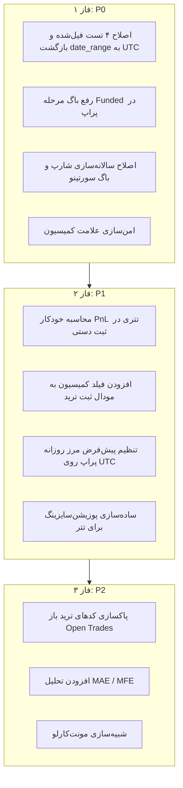

# 🧭 گزارش ارزیابی جامع MokTradeDesk
> **نویسنده:** تحلیل تخصصی توسط برنامه‌نویس ارشد و تریدر ارشد (Senior Engineer & Quant Trader)  
> **تاریخ:** ۱۴۰۵/۰۷/۲۸ (2026-10-19)  
> **وضعیت پروژه:** فازهای ۱ تا ۵۹ | ۷۶۳ تست (۷۵۸ پاس، ۱ xfail، ۴ خطا)  
> **دامنه کاربرد:** نرم‌افزار شخصی و لوکال (Local-First)، تک‌کاربره، معاملات ۱۰۰٪ تتری (USDT)، بدون ورود معاملات باز (فقط تریدهای بسته).

---

## فهرست مطالب
1. [خلاصه اجرایی](#۱-خلاصه-اجرایی)
2. [بخش اول: ارزیابی از دیدگاه تریدر ارشد (Trading & Risk Architecture)](#۲-بخش-اول-ارزیابی-از-دیدگاه-تریدر-ارشد)
   - [۲.۱ سایه منطق فارکس روی معاملات تتری (USDT)](#۲۱-سایه-منطق-فارکس-روی-معاملات-تتری-usdt)
   - [۲.۲ تضاد معماری با فرضیه «عدم ورود ترید باز»](#۲۲-تضاد-معماری-با-فرضیه-عدم-ورود-ترید-باز)
   - [۲.۳ خطاهای محاسباتی در شاخص‌های ریسک (Sharpe, Sortino, R-Multiple)](#۲۳-خطاهای-محاسباتی-در-شاخصهای-ریسک)
   - [۲.۴ نقاط ضعف و باگ‌های موتور قوانین پراپ (Prop Rule Engine)](#۲۴-نقاط-ضعف-و-باگهای-موتور-قوانین-پراپ)
   - [۲.۵ ابزارها و متریک‌های حیاتی مفقوده برای تریدر حرفه‌ای](#۲۵-ابزارها-و-متریکهای-حیاتی-مفقوده)
3. [بخش دوم: ارزیابی از دیدگاه برنامه‌نویس ارشد (Software Engineering & Architecture)](#۳-بخش-دوم-ارزیابی-از-دیدگاه-برنامهنویس-ارشد)
   - [۳.۱ ریشه‌یابی دقیق ۴ تست شکسته پروژه (Test Suite Failures)](#۳۱-ریشهیابی-دقیق-۴-تست-شکسته-پروژه)
   - [۳.۲ بحران و آشفتگی مناطق زمانی (Timezone Chaos & DST)](#۳۲-بحران-و-آشفتگی-مناطق-زمانی)
   - [۳.۳ ریسک علامت کارمزد در یکپارچگی داده‌ها (Data Integrity)](#۳۳-ریسک-علامت-کارمزد-در-یکپارچگی-دادهها)
   - [۳.۴ بدهی فنی و سربار ماژول‌های فیات/بانکی در یک دسک شخصی](#۳۴-بدهی-فنی-و-سربار-ماژولهای-فیاتبانکی)
   - [۳.۵ کاستی‌های تجربه کاربری در صفحه معاملات (`TradesPage.tsx`)](#۳۵-کاستیهای-تجربه-کاربری-در-صفحه-معاملات)
4. [بخش سوم: نقشه راه و پیشنهادات اولویت‌بندی‌شده (Actionable Roadmap)](#۴-بخش-سوم-نقشه-راه-و-پیشنهادات-اولویتبندیشده)
   - [فاز ۱: اصلاحات فوری و رفع باگ‌های فعال (P0)](#فاز-۱-اصلاحات-فوری-و-رفع-باگهای-فعال-p0)
   - [فاز ۲: بهینه‌سازی برای ترید تتری و تریدهای بسته (P1)](#فاز-۲-بهینهسازی-برای-ترید-تتری-و-تریدهای-بسته-p1)
   - [فاز ۳: امکانات پیشرفته کمی و تحلیلی (P2)](#فاز-۳-امکانات-پیشرفته-کمی-و-تحلیلی-p2)

---

## ۱. خلاصه اجرایی

پروژه **MokTradeDesk** یک دستاورد فنی بسیار منسجم و قابل تحسین برای یک نرم‌افزار مدیریت معاملات دسکتاپ است. طراحی پایگاه‌داده بر بستر **SQLite WAL mode** همراه با تنظیمات امنیتی `busy_timeout=5000` و قیدهای کلید خارجی `foreign_keys=ON`، استفاده از استانداردهای مدرن Pydantic و تایپ‌های TypeScript، و وجود بیش از ۷۵۰ تست خودکار نشان‌دهنده دقت بالا در پیاده‌سازی زیرساخت است.

با این حال، تطبیق وضعیت فعلی پروژه با شرایط واقعی کاربری شما:
1. **استفاده کاملاً شخصی و محلی** (عدم نیاز به سرورهای توزیع‌شده یا ماژول‌های پیچیده چندمستخدمی)،
2. **عدم ورود معامله باز** (ورود اختصاصی پوزیشن‌های بسته‌شده)،
3. **معاملات ۱۰۰٪ بر پایه تتر (USDT)**،

آشکار می‌کند که سیستم در چند نقطه با **پیچیدگی غیرضروری (Over-engineering)**، **خطاهای محاسباتی در شاخص‌های مدیریت ریسک** و **تضاد فرضیات فارکسی با ساختار ترید کریپتو/تتر** مواجه است. هدف این گزارش، روشن ساختن این گلوگاه‌ها و ارائه راهکارهای ساختاریافته است.

---

## ۲. بخش اول: ارزیابی از دیدگاه تریدر ارشد

### ۲.۱ سایه منطق فارکس روی معاملات تتری (USDT)
* **مشکل فعلی:** در ماژول ریسک (`domain/risk/position_sizing.py`) و جدول مشخصات نماد (`InstrumentSpec`)، محاسبات بر پایه منطق بازار فارکس (`min_lot`, `max_lot`, `lot_step`, `tick_size`, `tick_value`, `commission_per_lot`) انجام می‌شود:
  $$\text{denominator} = \text{sl\_distance} \times \text{value\_per\_price\_unit} + \text{commission\_per\_lot}$$
* **دیدگاه تریدر:** در معاملات کریپتو یا فیوچرز تتری (مانند BTCUSDT, ETHUSDT و ...)، رابطه ریسک بسیار شفاف و مستقیم است:
  $$\text{Position Size (Contracts/Coins)} = \frac{\text{Risk Amount (USDT)}}{|\text{Entry Price} - \text{Stop Loss Price}|}$$
  استفاده از سیستم لاتی فارکس باعث خطاهای گرد کردن (Rounding Errors) و پیچیدگی‌های غیرضروری در ثبت حجم می‌شود.
* **کارمزد (Commission):** در فارکس کارمزد به ازای هر لات ثابت است، اما در صرافی‌های کریپتو کارمزد به صورت **درصدی از ارزش کل معامله (Notional Value = Size × Price)** کسر می‌گردد (مثلاً Maker 0.02% و Taker 0.05%). سیستم کنونی ساختاری برای لحاظ کردن کارمزد درصدی تتری ندارد.

---

### ۲.۲ تضاد معماری با فرضیه «عدم ورود ترید باز»
* **مشکل فعلی:** در حال حاضر بخش وسیعی از کد در `prop_rule_engine.py`، `equity_engine.py`، `analytics.py` و `trades.py` برای پردازش مواردی همچون:
  - `close_time is None`
  - `floating_pnl`
  - `open_exposure`
  - `open_risk_percent`
  نوشته شده است.
* **دیدگاه تریدر:**
  1. با توجه به اینکه هیچ ترید بازی ثبت نمی‌شود، این کدها سربار پردازشی و ریسک ایجاد باگ‌های خاموش در منحنی اکوئیتی دارند.
  2. در ثبت دستی معامله (`trades.py:734`) وارد کردن `close_time` الزامی است، اما وارد کردن `pnl` اختیاری است! اگر تریدر سود را وارد نکند، مقدار در دیتابیس `None` شده و در نتیجه `net_pnl = 0` ثبت می‌شود!
  3. در صورتی که همه معاملات بر پایه تتر و بسته هستند، سود و زیان ناخالص باید به صورت **کاملاً خودکار و برخط** توسط سیستم محاسبه شود:
     $$\text{Long PnL} = (\text{Close Price} - \text{Open Price}) \times \text{Size}$$
     $$\text{Short PnL} = (\text{Open Price} - \text{Close Price}) \times \text{Size}$$
     اجبار کردن تریدر به محاسبه دستی PnL در اکسل یا ماشین‌حساب، احتمال خطای انسانی را بالا می‌برد.

---

### ۲.۳ خطاهای محاسباتی در شاخص‌های ریسک

#### الف) نسبت شارپ و سورتینو (عدم سالانه‌سازی):
* در `risk_engine.py` و `analytics.py`، نسبت شارپ روی بازده روزانه (Daily Return) محاسبه شده اما در جذر تعداد روزهای معاملاتی سال ($\sqrt{365}$ برای تتر/کریپتو یا $\sqrt{252}$ برای فارکس) ضرب نمی‌شود.
* در فرانت‌اند (`RiskManagementPage.tsx:64`)، همین شارپ روزانه بدون سالانه‌سازی با آستانه‌های سالانه مقایسه می‌شود:
  - شارپ $\ge 1.0 \rightarrow$ خوب (سبز)
  - شارپ بین $0.5$ تا $1.0 \rightarrow$ متوسط (زرد)
  - شارپ $< 0.5 \rightarrow$ ضعیف/خطرناک (قرمز)
* **نتیجه در عمل:** یک تریدر عالی با شارپ روزانه ۰.۰۸ (که معادل سالانه فوق‌العاده $0.08 \times \sqrt{365} \approx 1.52$ است)، در داشبورد با هشدار **«🔴 وضعیت ریسک: خطرناک»** مواجه می‌شود!

#### ب) باگ سورتینو در سیستم‌های با وین‌ریت بالا یا دوره‌های بدون ضرر:
* در `backend/app/domain/risk/risk_engine.py:181`:
  ```python
  if not negative_returns:
      return 0.0
  ```
  اگر استراتژی شما در یک بازه زمانی هیچ روز منفی نداشته باشد (Downside Deviation = 0)، سیستم سورتینو را به اشتباه `0.0` برمی‌گرداند؛ یعنی عملکرد عالی، بدترین نمره ممکن را دریافت می‌کند!

#### ج) محاسبه R-Multiple صرفاً بر اساس نوسان قیمت خام (Gross Price R):
* در `utils/trade_metrics.py`، شاخص R صرفاً از تقسیم فاصله ورود تا خروج بر فاصله ورود تا استاپ محاسبه می‌شود.
* در ترید واقعی، کارمزد صرافی رفت و برگشت از مقدار سود کسر می‌شود. برای یک معامله با سود ناخالص ۱R، ممکن است پس از کسر کارمزد تنها ۰.۷۵R باقی بماند. نبود شاخص **Net R**، امید ریاضی (Expectancy) استراتژی را بیش از واقعیت خوش‌بینانه نشان می‌دهد.

---

### ۲.۴ نقاط ضعف و باگ‌های موتور قوانین پراپ (Prop Rule Engine)

#### الف) باگ مرحله فاندد (`FUNDED_REAL`):
* در `backend/app/services/prop_rule_engine.py:186`:
  ```python
  if profit_target <= 0:
      violations.append("هدف سود تنظیم نشده")
      unconfigured = True
  ```
* این شرط برای همه مراحل اجرا می‌شود. در حالی که یک حساب ریل فاندد (Funded Stage)، **هیچ هدف سودی (Profit Target) ندارد** و تریدر هر میزان سود کسب کند سهم خود را برداشت می‌کند. این باگ باعث می‌شود تمام حساب‌های فاندد به اشتباه در وضعیت «تنظیم‌نشده / unconfigured» قفل شوند.

#### ب) خطای مرز تغییر روز (Day Boundary & Timezone):
* در `prop_rule_engine.py:614`، پیش‌فرض مرز تغییر روز `210` دقیقه (ساعت ۰۰:۰۰ به وقت تهران) در نظر گرفته شده است.
* هیچ شرکت پراپی در دنیا مبنای افت روزانه (Daily Drawdown) را نیمه‌شب تهران قرار نمی‌دهد؛ مبنای شرکت‌ها ساعت **00:00 UTC** یا **00:00 سرور بروکر (EET/CEST)** است.
* اگر شما معامله‌ای را در ساعت ۲۱:۳۰ UTC با ضرر ببندید و معامله دیگری را ساعت ۰۱:۰۰ UTC روز بعد ببندید:
  - برای پراپ فرم: دو معامله در دو روز مجزا هستند.
  - برای نرم‌افزار شما (با افست تهران): هر دو در یک روز تقویمی شمرده شده و هشدار نقض Daily DD صادر می‌شود (یا برعکس، ممکن است در پراپ بسوزید در حالی که نرم‌افزار نشان نمی‌دهد!).

---

### ۲.۵ ابزارها و متریک‌های حیاتی مفقوده
1. **MAE / MFE (Maximum Adverse / Favorable Excursion):** اندازه‌گیری اینکه قیمت در طول معامله چقدر به نفع شما یا علیه شما حرکت کرده است. این ابزار به تریدر نشان می‌دهد آیا استاپ‌لاس‌هایش بیش از حد بزرگ هستند یا تارگت‌ها قبل از خروج لمس می‌شوند.
2. **شبیه‌سازی مونت‌کارلو (Monte Carlo Simulation):** جابجا کردن تصادفی ترتیب ۱۰۰ تا ۵۰۰ معامله گذشته برای دیدن بدترین سناریوی ممکن در Drawdown در شرایط تغییر رژیم بازار.
3. **SQN (System Quality Number):** شاخص ون‌تارپ برای اندازه‌گیری درجه اعتبار آماری استراتژی بر اساس تعداد نمونه و توزیع سود.

---

## ۳. بخش دوم: ارزیابی از دیدگاه برنامه‌نویس ارشد

### ۳.۱ ریشه‌یابی دقیق ۴ تست شکسته پروژه
در اجرای تست‌های بک‌اند، ۴ تست زیر با خطا مواجه شدند:
1. `test_finance.py::test_real_summary_filters_on_close_time`: مقدار ۱۰۰ به جای ۸۰.
2. `test_phase46_time.py::test_date_range_includes_last_day`: تولید تاریخ `2024-12-31 20:30 UTC` به جای `2025-01-01 00:00 UTC`.
3. `test_phase48a_time_analysis.py::test_hour_uses_open_time`: عدم یافتن کلید ساعت ۳ به دلیل تبدیل به ساعت ۶:۳۰ تهران.
4. `test_trades.py::test_recent_trades_close_date_and_legacy_open_date`: حذف ترید ساعت ۲۳:۵۹ روز به دلیل افست زمانی.

**علت ریشه‌ای:** در فاز ۴۶.۵ فایل `backend/app/utils/date_range.py` به منظور پوشش تقویم جلالی دستکاری شده تا مبنا را ساعت ۰۰:۰۰ تهران قرار دهد (`astimezone(TEHRAN)`). اما چون دیتا در دیتابیس با UTC ذخیره می‌شود، بازه‌های ابتدا و انتهای روز ۳ ساعت و نیم جابجا شده و رکوردهای اواخر روز UTC را از دایره کوئری حذف می‌کنند.

---

### ۳.۲ بحران و آشفتگی مناطق زمانی (Timezone Chaos & DST)
در سورس‌کد فعلی ۴ منطقه زمانی به شکل هم‌زمان حضور دارند:
1. زمان UTC در دیتابیس
2. زمان سرور بروکر/پراپ (`server_utc_offset_minutes`)
3. زمان تهران (`to_tehran`)
4. زمان سیستم کلاینت/مرورگر

* **مشکل تغییر ساعت تابستانی (DST):** در `analysis_service.py:868` سشن‌های معاملاتی بر اساس ساعت تهران هاردکد شده‌اند (مثلاً ۱۰ تا ۱۶ تهران = London Only). از آنجا که ایران قانون تغییر ساعت تابستانی را لغو کرده اما بازارهای لندن و نیویورک در بهار و پاییز ساعت خود را تغییر می‌دهند، این سشن‌ها در نیمی از سال دچار **۱ ساعت خطای انطباق** با بازار واقعی هستند.

---

### ۳.۳ ریسک علامت کارمزد در یکپارچگی داده‌ها (Data Integrity)
* فرمول محاسبه در کل بک‌اند عبارت است از:
  $$\text{net\_pnl} = \text{pnl} + \text{commission} + \text{swap}$$
* در این فرمول فرض شده کمیسیون مقداری منفی است (مانند فایل‌های متاتریدر).
* اگر تریدر در فرم ثبت دستی عدد کارمزد را به صورت یک هزینه مثبت وارد کند (مثلاً ۲ تتر کارمزد)، سیستم به جای کم کردن، آن را با سود **جمع** می‌کند!
* در `TradeValidator.py:106` این موضوع بدون بررسی رها شده است:
  ```python
  if commission is not None and commission < 0:
      # کامیشن معمولاً منفی ذخیره می‌شود، اما اینجا چک نمی‌کنیم
      pass
  ```
  ورودی کارمزد باید همیشه نرمال‌سازی شود: `commission = -abs(commission)`.

---

### ۳.۴ بدهی فنی و سربار ماژول‌های فیات/بانکی
سیستم شامل مدل‌ها و روابط گسترده‌ای پیرامون حساب‌های بانکی، کارت به کارت، ارز ریال و دسته‌بندی‌های دخل‌وخرج شخصی است (`FinancialAccount`, `Transaction`, `Category`).  
برای تریدری که برنامه شخصی داشته و معاملاتش ۱۰۰٪ تتری است، بخش زیادی از این مدل‌ها به کدهای مرده یا سربار ذهنی تبدیل شده و نگهداری دیتابیس را سنگین‌تر می‌کند.

---

### ۳.۵ کاستی‌های تجربه کاربری در صفحه معاملات (`TradesPage.tsx`)
1. **غیبت فیلد کمیسیون:** در مودال ثبت معامله دستی (`TradesPage.tsx:405`) اصلاً فیلدی برای وارد کردن کمیسیون وجود ندارد!
2. **نبود پیش‌نمایش برخط (Live Calculation):** هنگام تایپ کردن قیمت ورود، خروج و استاپ‌لاس، نسبت R به R و مقدار PnL پیش‌بینی‌شده در همان لحظه در فرانت‌اند محاسبه و نمایش داده نمی‌شود تا تریدر قبل از دکمه ثبت آن را بازبینی کند.

---

## ۴. بخش سوم: نقشه راه و پیشنهادات اولویت‌بندی‌شده



### فاز ۱: اصلاحات فوری و رفع باگ‌های فعال (P0)
1. **اصلاح تست‌های فیل‌شده و بازگرداندن `date_range.py` به قرارداد UTC:**
   - فیلترهای زمانی دیتابیس باید به بازه استاندارد `[date 00:00:00 UTC, date+1 00:00:00 UTC)` بازگردند. تبدیل به تاریخ جلالی یا ساعت محلی صرفاً باید در لایه کامپوننت فرانت‌اند انجام شود نه در هسته کوئری‌های SQL دیتابیس.
2. **رفع باگ مرحله Funded در پراپ:**
   - شرط بررسی تارگت سود در `prop_rule_engine.py` باید برای `stage_type == StageType.FUNDED_REAL` نادیده گرفته شود تا حساب در حالت `unconfigured` قفل نشود.
3. **اصلاح سالانه‌سازی شاخص شارپ و باگ سورتینو:**
   - شارپ روزانه باید در جذر ۳۶۵ ضرب شود تا با استانداردهای داشبورد ریسک هم‌خوانی پیدا کند.
   - در صورت نبود روز منفی در سورتینو، مقدار معنادار بازگردانده شود.
4. **امن‌سازی علامت کمیسیون:**
   - تبدیل قطعی ورودی کمیسیون به عدد منفی در لایه `TradeValidator` و `trades.py`.

---

### فاز ۲: بهینه‌سازی برای ترید تتری و تریدهای بسته (P1)
1. **محاسبه خودکار PnL در ثبت دستی:**
   - در صورتی که کاربر `pnl` را وارد نکرد، بک‌اند با فرمول تتری بر اساس قیمت ورود، قیمت خروج، حجم و جهت، مقدار دقیق را محاسبه و ذخیره کند.
2. **افزودن فیلد کمیسیون به مودال ثبت دستی در فرانت‌اند:**
   - افزودن فیلد کارمزد به فرم ثبت معامله در `TradesPage.tsx`.
3. **تنظیم پیش‌فرض مرز روزانه پراپ روی 00:00 UTC:**
   - تغییر مقدار پیش‌فرض `day_boundary_utc_offset` از ۲۱۰ دقیقه به ۰.
4. **ساده‌سازی ماژول پوزیشن‌سایزینگ برای تتر:**
   - ایجاد تابع مستقیم محاسبه حجم بر اساس ریسک تتری: `Risk_USDT / (Entry - SL)`.

---

### فاز ۳: امکانات پیشرفته کمی و تحلیلی (P2)
1. **پاکسازی کدهای مربوط به معاملات باز (Open Trades Cleanup):**
   - با توجه به بسته بودن تمامی معاملات، حذف شاخه‌های محاسباتی اکوئیتی شناور جهت سبک‌سازی و افزایش سرعت لود.
2. **افزودن متریک MAE / MFE:**
   - افزودن فیلدهای بیشترین سود بالقوه و بیشترین ضرر تجربه شده به معامله.
3. **شبیه‌سازی مونت‌کارلو:**
   - افزودن ابزار شبیه‌سازی توالی تریدها در صفحه مدیریت ریسک.

---

## ۵. بخش پنجم: ارزیابی تخصصی استراتژی‌ها، آنالیزها و مقایسه‌ها (Strategies, Analytics & Comparison)

### ۵.۱ بخش مقایسه‌ها (`ComparisonPage.tsx` و `compare_versions`)
1. **گلوگاه وضعیت Stale / تحلیل‌نشده (نبود دکمه Re-analyze درون صفحه مقایسه):**
   - اگر نسخه‌ای به دلیل تغییر معاملات یا قواعد کهنه شده باشد یا هنوز تحلیل نشده باشد، جدول پیام خطای زرد می‌دهد، اما تریدر هیچ راهکاری در همان صفحه ندارد. او مجبور است صفحه مقایسه را ترک کند، به صفحه آنالیز برود، آن نسخه را پیدا و تحلیل کند، و دوباره به مقایسه برگردد.
   - **اصلاح:** افزودن دکمه‌های مستقیم «🔄 تحلیل سریع این نسخه» داخل همان ردیف جدول و «🔄 تحلیل همه نسخه‌های کهنه» بالای جدول.
2. **ایراد رادار چارت برای نسخه‌های بدون باخت (`no_losses`):**
   - در تابع `buildRadarData`، مقدار فاکتور سود برای نسخه‌های بدون زیان `null` شده و روی نمودار رادار حذف می‌شود؛ در حالی که طبق فرمول `version_score.py`، نمره PF برای این حالت باید ۱۰۰٪ در نظر گرفته شود.

### ۵.۲ بخش آنالیزها (`AnalysisPage.tsx` و `analysis_service.py`)
1. **بلعیدن خطای Stale در صفحه آنالیز (Silent 404 Catch):**
   - وقتی تحلیل یک نسخه کهنه می‌شود، `getAnalysisVersion` خطای ۴۰۴ با توضیح بازمی‌گرداند، اما فرانت‌اند آن را لاگ کرده و بدون هیچ هشداری صفحه را خالی نشان می‌دهد.
   - **اصلاح:** نمایش کارت هشدار شفاف به کاربر مبنی بر تغییر معاملات و نیاز به «تحلیل مجدد».
2. **عدم پشتیبانی از Query Params (نبود Deep Linking):**
   - صفحه آنالیز پارامترهای URL مانند `?scope=backtest&version_id=...` را نمی‌خواند و امکان هدایت مستقیم از استراتژی‌ها یا مقایسه‌ها به نسخه موردنظر وجود ندارد.

### ۵.۳ بخش استراتژی‌ها (`StrategyPage.tsx` و `strategies.py`)
1. **ارتباط ناوبری بین کارت‌های نسخه و صفحه آنالیز:**
   - کارت‌های نسخه باید امکان ورود مستقیم به آنالیز آن نسخه را در اختیار تریدر بگذارند.
2. **عدم پشتیبانی از رویداد `popstate` در `App.tsx`:**
   - برای جابجایی نرم بین صفحات با استفاده از دکمه‌های مرورگر یا لینک‌های داخلی.

